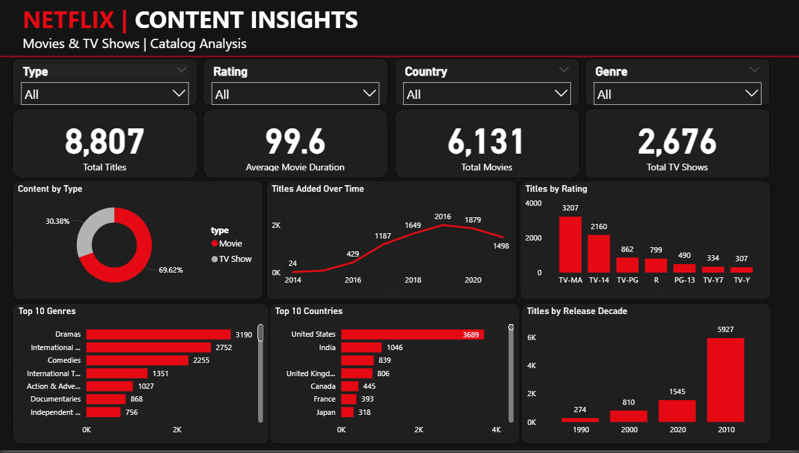

<h1 align="center">🎬 Netflix Content Insights Dashboard</h1>

<p align="center">
An interactive Power BI dashboard analyzing 8,807 Netflix movies and TV shows
</p>



---

## 📌 Project Overview
This project explores Netflix's content catalog to understand **what is available, where it comes from, and how the catalog has grown over time**. It is my first Power BI dashboard, covering the full workflow from data cleaning to a polished, interactive report.

## ❓ Business Questions
- How large is the catalog, and what is the Movie vs TV Show split?
- Which countries and genres dominate the catalog?
- How has the number of titles added per year changed?
- Which age ratings are most common?
- How is content distributed across release decades?

## 💡 Key Insights
| Metric | Finding |
|---|---|
| **Total titles** | 8,807 (6,131 movies and 2,676 TV shows) |
| **Content mix** | 69.6% movies, 30.4% TV shows |
| **Average movie length** | 99.6 minutes |
| **Top country** | United States (3,689 titles), followed by India (1,046) and the UK (806) |
| **Top genres** | Dramas, International Movies and Comedies |
| **Top rating** | TV-MA (3,207 titles), showing a focus on mature audiences |
| **Growth** | Titles added per year rose sharply after 2016 and peaked in 2019 at about 2,000 titles |
| **Release decade** | Most titles were released in the 2010s (5,927) |

> Note: the 2020s bar covers only 2020 to 2021, so it is a partial decade.

## 🛠️ Tools & Skills
- **Power BI Desktop**: dashboard design and interactivity
- **Power Query**: data cleaning and transformation
- **DAX**: KPI measures
- **Data modeling**: separate tables for titles, genres and countries

## 🧹 Data Cleaning
- Trimmed and cleaned text columns
- Found **2 corrupted rows** (line breaks in descriptions had split records) and removed them, correcting the total from 8,809 to **8,807**
- Split multi-value genre and country columns into separate tables (`Netflix_Genres`, `Netflix_Countries`)
- Created `added_year`, `release_decade` and `duration_value` columns
- Handled null and error values
- Validated results: **6,131 movies + 2,676 TV shows = 8,807 titles**

## 📐 DAX Measures
```DAX
Total Titles = DISTINCTCOUNT(Netflix_Titles[show_id])

Total Movies = CALCULATE([Total Titles], Netflix_Titles[type] = "Movie")

Total TV Shows = CALCULATE([Total Titles], Netflix_Titles[type] = "TV Show")

Avg Movie Duration =
CALCULATE(AVERAGE(Netflix_Titles[duration_value]), Netflix_Titles[type] = "Movie")
```

## 📊 Dashboard Features
- **4 slicers**: Type, Rating, Country, Genre
- **4 KPI cards**: Total Titles, Movies, TV Shows, Average Movie Duration
- **6 visuals**: donut chart, line chart, column charts and Top 10 bar charts
- Dark Netflix-inspired theme with a consistent grid layout

## 🚀 How to Explore
1. Download [`Netflix_dashboard.pbix`](Netflix_dashboard.pbix).
2. Open it in [Power BI Desktop](https://powerbi.microsoft.com/desktop/) (free, Windows).
3. Use the slicers to filter the dashboard.

## 📂 Repository Contents
| File | Description |
|---|---|
| `Netflix_dashboard.pbix` | Power BI dashboard file |
| `dashboard.png` | Dashboard screenshot |
| `README.md` | Project documentation |

## 📚 Data Source
Netflix Movies and TV Shows dataset from Kaggle.

## 👤 Author
**Abida** | [LinkedIn]([[paste your LinkedIn link](https://www.linkedin.com/in/aabida-irfan-shaikh)]) | [GitHub](https://github.com/abida2005)

⭐ If you found this project useful, feel free to star the repository.
